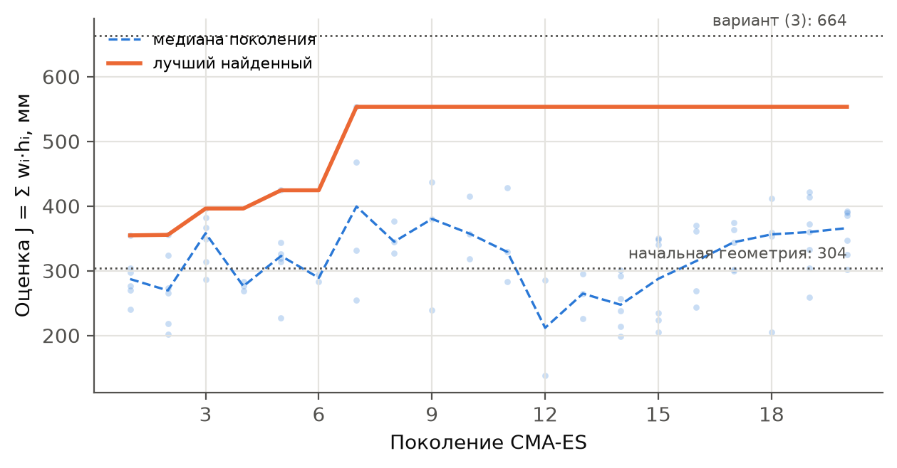
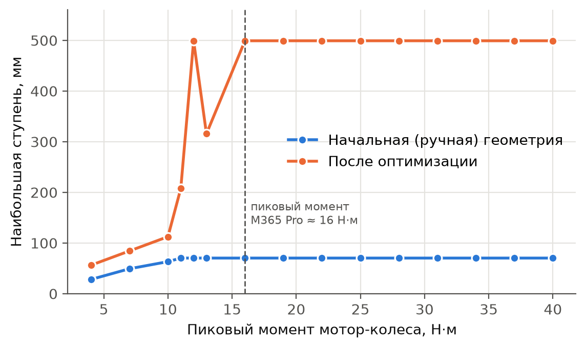
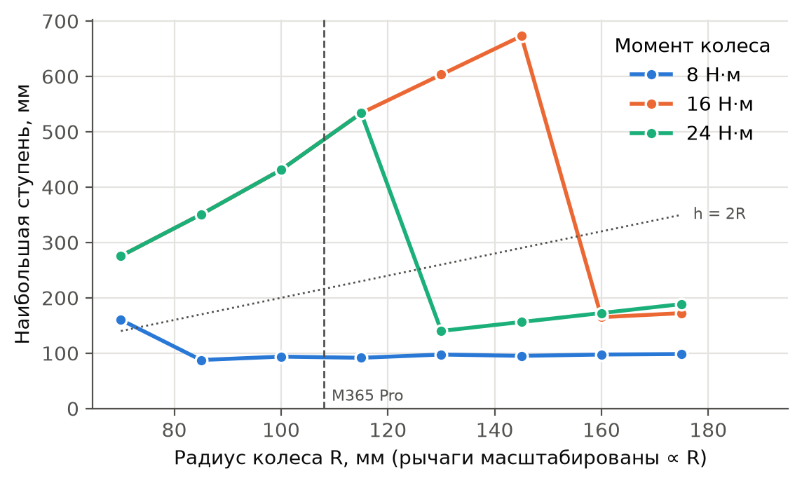
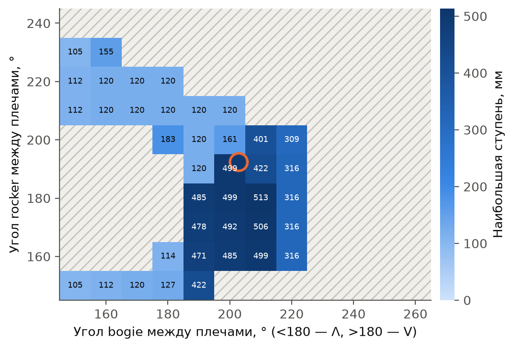

# Подбор геометрии подвески rocker-bogie методом CMA-ES по динамическому моделированию

**Аннотация.** Разработана программа, подбирающая геометрию рычагов шестиколёсной подвески rocker-bogie под заданные габарит (1200 × 600 мм), колесо и мотор. Каждый вариант проверяется динамическими прогонами в MuJoCo, а геометрия подбирается эволюционной стратегией CMA-ES. Для мотор-колёс Xiaomi M365 Pro (R = 108 мм, 16 Н·м) и массы ≈ 50 кг предел ступени вырос с 70 мм у исходной ручной геометрии до ≈ 500 мм (4,6 R).

## 1. Что считается проходимостью

Ровер должен преодолевать одиночные препятствия передним и задним ходом. Рассматриваются пять препятствий с кромкой 90°:

- подъём на ступень;
- съезд со ступени;
- ров;
- кочка шириной 120 мм (кирпич);
- кочка шириной 250 мм (бревно).

Прогон в MuJoCo (шаг 1 мс) учитывает трение колёс (μ = 0,8), упругую шину, характеристику мотора, дифференциал и касания труб и стоек о препятствие. **Прогон успешен**, если все колёса прошли препятствие. **Неудача** — касание рычага, опрокидывание или остановка на 6 с; её причина (геометрия, момент или пробуксовка) сохраняется.

**Проходимость по препятствию *i*** — наибольший размер *hᵢ* (высота ступени или кочки, ширина рва), при котором прогон успешен. Он ищется делением пополам с точностью 5 мм. Из двух направлений движения берётся худшее.

## 2. Параметры и начальная точка

Каждый рычаг задаётся двумя плечами и углом между ними: при угле < 180° рычаг имеет форму Λ, при угле > 180° — V (рис. 1). Свободных параметров восемь:

- **bogie:** два плеча и угол;
- **rocker:** два плеча и угол;
- **стойки:** наклон стоек крайних колёс и наклон стойки среднего колеса.

Радиус колеса, высоты стоек, масса и момент фиксированы. Ограничения проверяются до моделирования: длина ≤ 1200 мм, шарниры не ниже диаметра колеса, колёса не пересекаются.

**Начальная точка** — геометрия, введённая вручную по изображениям марсоходов: колёса в точках 0, 380 и 940 мм, главный шарнир (600; 470) мм, шарнир bogie (190; 390) мм. Это bogie 193/231 мм с углом 136° и rocker 418/358 мм с углом 151°, оба рычага Λ-образные. Такая геометрия проходит ступень лишь 70 мм.

> **[Рис. 1 — вставить]** Скриншот вкладки «Геометрия» с начальной геометрией (загрузить `report/start_geometry.json`). Должны быть видны плечи и углы bogie и rocker и шарниры. Подпись: «Параметризация борта и начальная ручная геометрия».

## 3. Метрика

Максимизируется взвешенная сумма пределов:

$$J=\sum_i w_i h_i \to \max,\qquad w_{\text{ступень}}=1,\; w_{\text{съезд}}=0{,}3,\; w_{\text{ров}}=w_{\text{кочки}}=0{,}5.$$

Почему такие веса:

- **Ступень** — самое трудное и характерное для rocker-bogie препятствие, поэтому у неё наибольший вес.
- **Съезд** даётся в 2–3 раза легче подъёма; малый вес не даёт ему заглушить остальные слагаемые.
- **Кочки** проверяют то, чего не видит ступень: узкое препятствие проходит между колёсами и задевает трубы.
- **Худшее направление** берётся потому, что ровер должен проходить препятствие в обе стороны.

Сумма в миллиметрах интерпретируема, а веса настраиваются под применение.

В программе есть и вторая цель — **наименьший момент колеса**, при котором проходится заданный набор препятствий. Колесо лезет по стенке только за счёт трения (f ≤ τ/R), поэтому момент — физический ограничитель, и он меняется с геометрией плавно. Но если какое-то препятствие непроходимо при любом моменте, эта цель вырождается в плато бесконечных значений. Поэтому основной выбрана *J*.

## 4. Метод оптимизации

Функция *J* — «чёрный ящик» без градиента:

- исход прогона двоичный, а предел округлён до шага поиска;
- взятие худшего направления даёт изломы;
- контакты переключаются скачком.

Поэтому применена безградиентная эволюционная стратегия **CMA-ES**:

1. Параметры нормируются в [0, 1]. Старт — ручная геометрия, начальный шаг σ₀ = 0,3.
2. Каждое поколение — 10 вариантов из многомерного нормального распределения.
3. Среднее сдвигается к лучшим вариантам, ковариация вытягивается вдоль удачных направлений, шаг σ адаптируется. Это важно, т. к. плечо и угол рычага действуют совместно. Дифференциальная эволюция, использованная ранее, за тот же бюджет делала в 3–4 раза меньше поколений.
4. Недопустимая геометрия не моделируется и получает штраф 10⁴ + величина нарушения в мм, так что поиск видит, куда возвращаться.
5. Поиск каждого предела стартует от значения у лучшего варианта, что даёт в 1,5–2 раза меньше прогонов.
6. Лучшие варианты в конце уточняются с более мелким шагом.

20 поколений — это ≈ 2000 поисков пределов, ≈ 15 мин на 16 ядрах.

## 5. Результаты

**Сходимость (рис. 2).** За 7 поколений *J* выросла с 304 до 558 мм. Ступень увеличилась с 70 до 202 мм, съезд — с 238 до 423 мм, кочки — с 70 до 133–135 мм. Вариант (3), полученный более длинными запусками, даёт *J* = 664 мм. Дальнейшее плато лучшего значения при растущей медиане — следствие кусочно-постоянной *J*; на практике помогают перезапуски из найденной точки.

*Рис. 2 — Сходимость CMA-ES: точки — варианты, пунктир — медиана поколения, линия — лучший вариант.*

**Момент (рис. 3).** У ручной геометрии предел ≈ 70 мм при любом моменте: мешает касание стойки, т. е. ограничение геометрическое. У оптимизированной геометрии до 10 Н·м ограничивает момент. С 12–16 Н·м предел выходит на ≈ 500 мм, где его держат касание трубы bogie и сцепление. Момент M365 Pro находится как раз на выходе на плато.

*Рис. 3 — Наибольшая ступень в зависимости от пикового момента колеса.*

**Радиус колеса (рис. 4).** Чтобы не привязываться к конкретному колесу, геометрия масштабировалась подобно (все длины ∝ R) при неизменной массе. Видны три режима:

- **Геометрический** (16 Н·м, R ≤ 145 мм): предел растёт линейно, h ≈ 4–4,6 R, т. е. вдвое больше диаметра колеса.
- **Моментный:** требуемый момент τ ≈ F·R растёт с радиусом, поэтому при R ≥ 160 мм предел обрушивается до 170 мм, а при 8 Н·м он ≈ 95 мм при любом R.
- **Сцепной** (24 Н·м, R ≥ 130 мм): колёса пробуксовывают на стенке.

Значит, колесо выгодно увеличивать, только если момент растёт вместе с радиусом.

*Рис. 4 — Наибольшая ступень в зависимости от радиуса колеса (рычаги масштабированы ∝ R).*

**Форма рычагов (рис. 5).** Высокий предел (470–510 мм) даёт лишь узкая область: слегка V-образный bogie (190–210°) и rocker 160–190°. Λ-образный bogie даёт не более 180 мм. Резкие границы между областями — та самая кусочно-постоянная структура, ради которой нужен безградиентный метод.

*Рис. 5 — Наибольшая ступень по углам bogie и rocker при 16 Н·м; кружок — вариант (3), штриховка — недопустимая геометрия.*

> **[Рис. 6 — вставить, по желанию]** Две схемы рядом: начальная (`report/start_geometry.json`) и вариант (3) (`Подвески/rocker_bogie_variant (3).json`). Подпись: «Начальная и оптимизированная геометрия борта».

## 6. Выводы

1. Проходимость определена как наибольшие размеры пяти типовых препятствий при худшем направлении. Моделирование показывает и предел, и его причину: геометрию, момент или сцепление.
2. Цель кусочно-постоянна, поэтому применён CMA-ES со штрафом за нарушения и поиском пределов от подсказки. Из ручной геометрии за 20 поколений оценка выросла в 1,8 раза, а предел ступени вырос с 70 до ≈ 500 мм.
3. Предел ступени пропорционален радиусу колеса, пока хватает момента. Поэтому колесо, мотор и геометрию рычагов нужно выбирать совместно.
